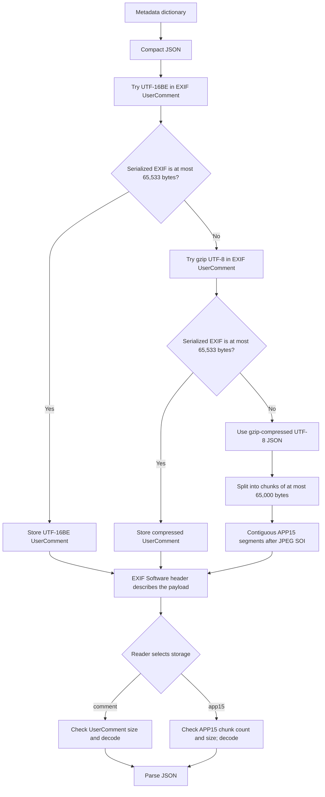

# Technical Details

## JPEG Metadata Storage

The Save as JPEG node embeds its metadata dictionary in the JPEG file. The
writer serializes the dictionary as compact JSON, then stores the JSON bytes in
one of two places. An EXIF `Software` field identifies the storage method and
how to decode the payload.



### EXIF Header

The EXIF `Software` tag contains an ASCII, NUL-terminated header such as:

```text
ComfyUI-Image-Shelf;v=1;ext=0.1.0;storage=comment;size=123;chunks=1;encoding=utf-16be
```

The fields identify the metadata format version (`v`), extension version
(`ext`), storage (`comment` or `app15`), encoding, payload byte size, and chunk
count. The header is the reader's guide to locating and decoding the payload.
The extension version shown is the version currently passed by the Save as
JPEG node; it can vary by caller.

### EXIF UserComment

For smaller metadata, the writer tries EXIF `UserComment` storage in this order:

1. `utf-16be`: the JSON text encoded as UTF-16 big-endian.
2. `gzip_utf-8`: the JSON text compressed with gzip after UTF-8 encoding.

The EXIF UserComment value begins with an eight-byte encoding prefix. The
UTF-16BE representation uses `UNICODE\0`; the gzip representation uses eight
zero bytes, the EXIF "undefined" prefix. The `encoding` field in `Software`
disambiguates the compressed form.

For each representation, the writer serializes the EXIF data and checks that
it is no larger than 65,533 bytes, the maximum JPEG segment payload. If neither
representation fits, it removes the provisional `UserComment` and uses APP15
storage. For `storage=comment`, `size` counts the entire UserComment value,
including its eight-byte prefix, and `chunks` is 1.

### APP15 Chunks

If the metadata is too large for EXIF UserComment, the writer gzip-compresses
the JSON text as UTF-8 and splits the compressed bytes into chunks of at most
65,000 bytes. Each chunk is stored verbatim in an APP15 marker segment; there is
no custom header inside an individual chunk. The contiguous APP15 segments are
inserted immediately after the JPEG start-of-image (SOI) marker.

For `storage=app15`, `size` is the total compressed payload size before
splitting, excluding JPEG marker and segment-length bytes. `chunks` is the
number of APP15 segments. The EXIF `Software` header carries these values so
the reader can reassemble the payload without per-chunk metadata.

### Reading and Validation

The reader parses the EXIF `Software` header first. For `comment` storage, it
reads `UserComment` and checks its length against `size`. For `app15` storage,
it scans JPEG segments before the start-of-scan marker, collects the expected
number of contiguous APP15 segments, and checks that their combined payload
length matches `size`.

After validation, the reader decodes the bytes according to `encoding` and
parses the result as JSON. Missing EXIF fields, mismatched sizes or chunk
counts, unsupported encodings, invalid compressed data, or invalid JSON cause
metadata reading to fail rather than returning a partial workflow.
